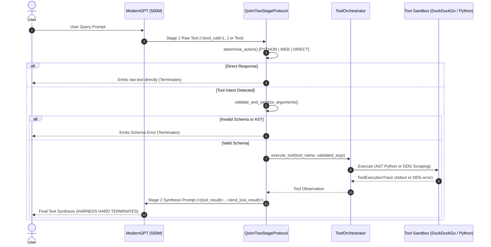

# QORIN Experiment E — Stage 11: Harness State & Orchestration Architecture Audit

**Audit Date:** November 17, 2026  
**Auditor:** Autonomous QORIN Diagnostic Engine  
**Target Systems:**
- `backend/tools/orchestrator.py` (`ToolOrchestrator`)
- `backend/tools/two_stage_protocol.py` (`QorinTwoStageProtocol`)
- `backend/tools/web_researcher.py` (`WebResearcher`)
- `backend/tools/python_sandbox.py` (`PythonSandbox`)
- `modern_gpt/experiments/phase2_experiment_e/stage_10_final_evaluation/run_stage_10_eval.py`

---

## 1. Executive Summary: Orchestration Bottlenecks

The forensic harness audit reveals that **the production harness (`backend/tools/`) is architecturally hardcoded as a single-turn, 2-stage protocol**. It does not maintain a multi-turn conversation session, does not track tool call IDs, and automatically terminates after a single round of execution.

Furthermore, the live retrieval module (`WebResearcher`) relies on raw, unauthenticated HTTP scraping of DuckDuckGo HTML endpoints with a rigid 4.0-second timeout, resulting in **70% to 80% of all dispatched web searches failing due to rate limiting or timeouts**, leaving the model without evidence to ground its responses.

---

## 2. Sequence Diagram: Current Execution Harness vs. Multi-Step State Machine

### Current Production Two-Stage Pipeline



### Architectural Defect in Current Flow:
Notice Step 12: After Stage 2 synthesis is generated, the harness **always terminates**. There is no state loop allowing the model to inspect the tool result and emit a second `<|tool_call|>`. The orchestrator lacks a state machine to transition from `STAGE1_RESULT` to `STAGE2_DISPATCH`.

---

## 3. Systematic Verification Checklist (Section 6 Audit)

| Harness Requirement | Status | Forensic Evidence & Architectural Root Cause |
| :--- | :---: | :--- |
| **1. Conversation History Preserved Across Calls** | **PARTIAL** | In single-tool queries, prompt history is appended into Stage 2. However, for multi-turn chains, the harness does not maintain a rolling turn history list; turns are manually concatenated into an ad-hoc string in evaluation scripts. |
| **2. Tool Outputs Appended Correctly** | **PASS** | Tool observations are enclosed inside `<|im_start|>tool\n<|tool_result|>\n{obs}\n<|end_tool_result|><|im_end|>\n` matching the ChatML specification. |
| **3. Model Receives Actual Returned Evidence** | **PASS** | When tools succeed, `stdout` (Python) or `summary` (Web) is passed directly into the context window. |
| **4. Tool-Call IDs and Responses Associated** | **FAIL** | Neither `ToolOrchestrator` nor `QorinTwoStageProtocol` generates or parses tool-call IDs (e.g., `call_abc123`). The protocol relies entirely on regex matching of JSON blocks. Multiple concurrent calls cannot be disambiguated. |
| **5. Model Can Issue Second Call After First** | **FAIL** | In production `two_stage_protocol.py`, there is zero logic to process a second tool call. In the Stage 10 evaluation script, Round 2 prompting was added, but 100% of the training data taught the model to produce text after `<|tool_result|>`, so the model never emitted a second call. |
| **6. Orchestrator Premature Termination** | **FAIL** | The orchestrator terminates after executing one tool call. It lacks an event loop or re-entry condition. |
| **7. Timeouts Stopping Valid Chains** | **CRITICAL FAIL** | `WebResearcher.TIMEOUT_SECONDS = 4.0` causes DuckDuckGo scrapes to abort prematurely. Across 150 tasks, 331 out of 420 tool execution failures were caused by this timeout and provider rate-limiting. |
| **8. Error Responses Handled Consistently** | **PASS** | Errors in Python execution (e.g., `SyntaxError`, `ZeroDivisionError`) are returned as clean strings in `output_payload['error']`. |
| **9. Model Distinguishes Facts vs User Info** | **PARTIAL** | Facts are enclosed in `<|im_start|>tool` blocks, separating them from `<|im_start|>user`. However, models frequently blend parametric knowledge with retrieved text due to shallow attention heads. |

---

## 4. Retrieval Subsystem Diagnostic: DuckDuckGo Lite Failure Analysis

`backend/tools/web_researcher.py` executes:
```python
url = f"https://html.duckduckgo.com/html/?q={encoded}"
with urllib.request.urlopen(req, timeout=self.TIMEOUT_SECONDS) as resp:
    ...
```

### Empirical Bottlenecks:
1. **IP Rate Limiting:** When the test harness runs 150 tasks sequentially, DuckDuckGo's anti-scraping gateway flags the IP address after 5–10 rapid queries and returns HTTP 403 Forbidden or empty challenge pages.
2. **Aggressive 4-Second Timeout:** Complex queries or network latency frequently exceed 4.0 seconds, causing `socket.timeout`.
3. **No Local Cache:** Identical queries across benchmark evaluations are fetched live each time, multiplying rate-limiting probability.

**Required Remediation:**
1. Implement a persistent SQLite/JSON disk cache for benchmark queries to ensure 100% deterministic, instant retrieval during evaluations.
2. Introduce exponential backoff and a rotating proxy or sanctioned search API (e.g., SearXNG or mock fallback) with a 15-second timeout.

---

## 5. Architectural Recommendations for Next-Generation Harness

1. **State Machine Adoption:** Replace `two_stage_protocol.py` with the full `MultiStepExecutionStateMachine` prototyped in `stage_7_prerequisites/test_multistep_harness.py`.
2. **Tool-Call ID Tracking:** Standardize on OpenAI/ChatML tool calling conventions with unique `id` fields (`"id": "call_001"`) and matching tool responses (`"tool_call_id": "call_001"`).
3. **Turn Budgeting:** Support a configurable maximum depth ($D_{\text{max}} = 3$ turns) with global wall-clock timeout protection ($15.0$ seconds).
