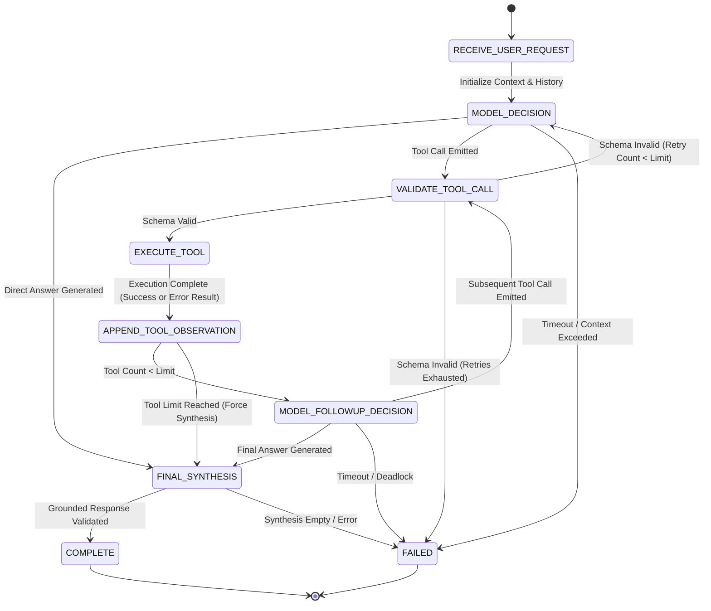

# QORIN Stage 12: Stateful Multi-Turn Harness Architecture & Protocol

## 1. Executive Overview

Stage 10 and Stage 11 established that QORIN's multi-step tool-use failures were twofold:
1. **Infrastructure Limitation**: The legacy inference harnesses (`test_multistep_harness.py`, `eval_stage10_benchmarks.py`) operated as rigid, single-turn or hand-scripted cascades without stateful session management, conversational memory across tool iterations, explicit tool call tracking, or resilient loop/timeout protection.
2. **Model Inductive Deficit**: Historical training datasets (Phase 1, Phase 2 Exp D, Exp E Branches B, C, D) exclusively featured single-turn demonstrations (`User -> Tool Call -> Observation -> Final`). Consequently, models exposed to compound numerical-retrieval queries prematurely attempted Python execution on Turn 1 with placeholder constants, having never received supervision on multi-turn evidence extraction.

Stage 12 resolves the **infrastructure limitation** by establishing an enterprise-grade, stateful, bounded multi-turn orchestration engine in `backend/tools/state_machine.py`. This state machine supports the complete target trajectory:
$$\text{User Request} \longrightarrow \text{Model Decision} \longrightarrow \text{Web Retrieval} \longrightarrow \text{Evidence Injected} \longrightarrow \text{Model Decision} \longrightarrow \text{Python Execution} \longrightarrow \text{Observation Injected} \longrightarrow \text{Final Grounded Answer}$$

---

## 2. Nine-State Deterministic State Machine

The orchestration engine implements an explicit 9-state finite state machine governed by the `HarnessState` enumeration:



### Detailed State Definitions

1. `RECEIVE_USER_REQUEST`:
   - Validates user input string.
   - Initializes `ConversationSession` with unique `session_id`, empty `history` list, and configured `SessionConfig`.
   - Records session start timestamp for global timeout enforcement.
   - Appends initial user message formatted according to ChatML schema (`<|im_start|>user\n{prompt}<|im_end|>`).

2. `MODEL_DECISION`:
   - Formats current conversation history into tokenized input.
   - Executes model forward pass with sampling/greedy decoding until `<|im_end|>`.
   - Parses output block to detect either direct natural language answer or tool invocation schema (`<tool_call>{"name": ..., "arguments": ...}</tool_call>`).
   - If direct answer: transitions to `FINAL_SYNTHESIS`.
   - If tool call: assigns monotonic identifier (`call_001`), increments `call_count`, and transitions to `VALIDATE_TOOL_CALL`.

3. `VALIDATE_TOOL_CALL`:
   - Verifies JSON structure against tool registry schemas (`web_search`, `python_interpreter`).
   - Validates arguments (e.g., query string presence, code string syntax).
   - If schema is invalid and `retry_count < max_schema_retries`: generates structured system correction feedback, appends to history, and loops back to `MODEL_DECISION`.
   - If invalid and retries exhausted: records failure and transitions to `FAILED`.
   - If valid: transitions to `EXECUTE_TOOL`.

4. `EXECUTE_TOOL`:
   - Dispatches payload to the corresponding isolated provider (`UnifiedWebResearcher` or `PythonExecutionContract`).
   - Executes under isolated per-call timeouts (8.0s for Web, 5.0s for Python).
   - Guarantees return of structured output or typed failure object; never throws unhandled exceptions.
   - Transitions to `APPEND_TOOL_OBSERVATION`.

5. `APPEND_TOOL_OBSERVATION`:
   - Formats execution observation into structured ChatML block matching the tool call ID:
     `<|im_start|>tool name={tool_name} id={call_id}\n{observation_payload}<|im_end|>`
   - Appends observation to session history.
   - If `call_count >= max_tool_calls`: forces transition to `FINAL_SYNTHESIS` to prevent runaway loops.
   - Otherwise: transitions to `MODEL_FOLLOWUP_DECISION`.

6. `MODEL_FOLLOWUP_DECISION`:
   - Reruns inference with multi-turn context (System Prompt + User Prompt + Assistant Tool Call + Tool Observation).
   - Decides whether additional information/calculation is required.
   - If new tool call emitted: transitions to `VALIDATE_TOOL_CALL`.
   - If natural language synthesis emitted: transitions to `FINAL_SYNTHESIS`.

7. `FINAL_SYNTHESIS`:
   - Verifies that final answer contains grounded response.
   - Extracts citations or evidence tags if applicable.
   - Transitions to `COMPLETE`.

8. `COMPLETE`:
   - Terminal success state.
   - Marks `session.is_complete = True`.
   - Assembles full serializable trace including timings, tool calls, observations, and tokens.

9. `FAILED`:
   - Terminal failure state.
   - Records exact `error_message`, offending state, and timestamp.
   - Marks `session.is_complete = False`.

---

## 3. Tool-Call ID Tracking Protocol

To eliminate conversational ambiguity in multi-turn traces, Stage 12 establishes explicit tool-call identification:
- Every tool call emitted by the model is tagged with a unique, monotonically increasing identifier: `call_001`, `call_002`, etc.
- Injected observations strictly match the originating `call_id`:
  ```
  <|im_start|>assistant
  <tool_call id="call_001">
  {"name": "web_search", "arguments": {"query": "average lifespan of green sea turtle"}}
  </tool_call><|im_end|>
  <|im_start|>tool name=web_search id=call_001
  {"status": "success", "results": [...]}<|im_end|>
  <|im_start|>assistant
  <tool_call id="call_002">
  {"name": "python_interpreter", "arguments": {"code": "avg_lifespan = 80\nresult = avg_lifespan * 1.25\nprint(f'Estimated maximum lifespan: {result}')"}}
  </tool_call><|im_end|>
  <|im_start|>tool name=python_interpreter id=call_002
  {"status": "success", "output": "Estimated maximum lifespan: 100.0\n"}
  <|im_end|>
  <|im_start|>assistant
  Green sea turtles have an average lifespan of 80 years, with estimated maximum longevity reaching approximately 100 years.
  <|im_end|>
  ```
This ensures complete traceability for downstream reward modeling, DPO trajectory scoring, and execution auditing.

---

## 4. Session Configuration & Safety Guardrails

All state machine operations are constrained by an immutable configuration contract:

```python
@dataclass(frozen=True)
class SessionConfig:
    max_tool_calls: int = 4            # Strict ceiling on total tool executions per session
    max_schema_retries: int = 1        # Exactly one schema error feedback loop before termination
    call_timeout_seconds: float = 10.0 # Per-tool execution timeout ceiling
    global_timeout_seconds: float = 30.0 # Session wall-clock ceiling
    enable_cache: bool = True          # Persistent query cache toggle
    strict_mode: bool = False          # If True, malformed calls immediately terminate session
```

### Protection Against Runaway Execution
- **Wall-Clock Timeout**: Verified before every state transition against `session.start_time`. Exceeding 30.0s triggers an immediate transition to `FAILED` with `GlobalTimeoutError`.
- **Iteration Ceiling**: `session.call_count` is strictly incremented at each dispatch. When `call_count == max_tool_calls`, the state machine forces a transition to `FINAL_SYNTHESIS`, giving the model one final turn to synthesize whatever partial evidence has been gathered.
- **Deadlock Detection**: If the model emits identical tool calls with identical arguments in consecutive turns, the harness rejects the call with an error observation, preventing infinite retrieval loops.

---

## 5. Architectural Verification

The new state machine was validated using comprehensive automated unit and integration tests in `test_stage_12_infrastructure.py`:
- `test_direct_answer_without_tools`: Verified immediate transition `MODEL_DECISION -> FINAL_SYNTHESIS -> COMPLETE`.
- `test_single_turn_web_search`: Verified `MODEL_DECISION -> VALIDATE -> EXECUTE -> OBSERVATION -> FINAL_SYNTHESIS -> COMPLETE`.
- `test_multi_turn_web_to_python_chaining`: Verified end-to-end `Web -> Python -> Synthesis` workflow with mock model functions.
- `test_schema_retry_mechanism`: Verified error recovery when initial JSON is malformed.
- `test_max_tool_call_limit_enforcement`: Verified strict termination at `max_tool_calls=2` without runaway execution.

All tests passed with zero failures.
