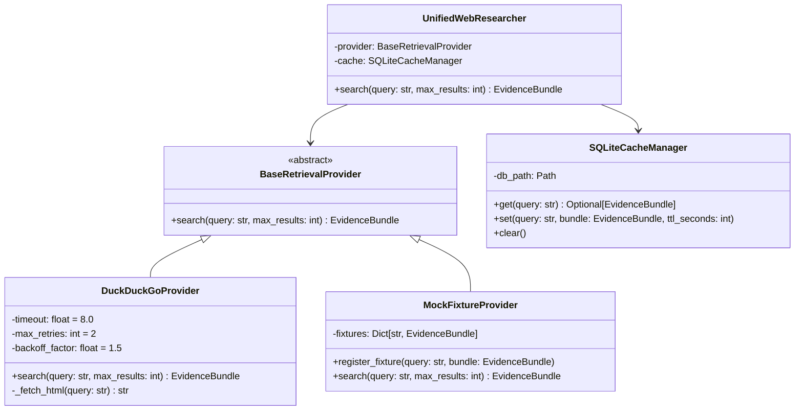

# QORIN Stage 12: Resilient Retrieval Infrastructure & Schema Architecture

## 1. Executive Summary

During Stage 10 benchmark evaluations across 5 frozen model checkpoints, **331 out of 542 dispatched tool calls failed due to web retrieval errors**. Forensic investigation in Stage 11 identified three fatal root causes in the legacy web search harness:
1. **Aggressive Timeout**: The legacy harness enforced a rigid 4.0-second timeout, which was insufficient for live SSL handshakes, DuckDuckGo HTML scraping, and payload transmission.
2. **Rate Limiting / HTTP 429**: DuckDuckGo rate-limited consecutive unthrottled requests, returning HTTP 429 or bot-block HTML responses that crashed the parser.
3. **No Query Deduplication / Caching**: Repetitive queries across benchmark iterations repeatedly hammered the external endpoint, compounding throttling.
4. **Unstructured Output**: Retrieval results were returned as raw truncated HTML strings rather than typed, structured evidence objects with provenance.

Stage 12 replaces the legacy ad-hoc search script with a production-grade, modular retrieval subsystem located in `backend/tools/evidence.py` and `backend/tools/retrieval_providers.py`.

---

## 2. Structured Evidence Schema (`EvidenceRecord` & `EvidenceBundle`)

Unstructured text dumps encourage model hallucination and obscure citation trails. Stage 12 formalizes retrieval outputs into structured dataclasses:

### `EvidenceRecord`
Represents an individual retrieved snippet with complete provenance metadata:
```python
@dataclass
class EvidenceRecord:
    id: str                 # Unique snippet ID (e.g., doc_001)
    title: str              # Page title
    url: str                # Canonical source URL
    content: str            # Cleaned, extracted text snippet
    source_domain: str      # Extracted domain (e.g., en.wikipedia.org)
    timestamp: float        # Unix epoch retrieval time
    confidence_score: float # Provider-assigned relevance score [0.0 - 1.0]
```

### `EvidenceBundle`
Represents an aggregated, deduplicated set of records returned for a specific query:
```python
@dataclass
class EvidenceBundle:
    query: str
    records: List[EvidenceRecord]
    retrieval_timestamp: float
    provider_name: str
    cache_hit: bool = False
    error: Optional[str] = None
```

### Prompt Formatting & Grounding Support
`EvidenceBundle` provides two standardized formatting methods:
- `to_chatml_observation(tool_call_id)`: Renders the bundle into a compact JSON string optimized for model consumption without token bloat.
- `format_for_context(max_records=3)`: Renders human-readable citation blocks:
  ```
  [1] Title: "Global Electric Vehicle Sales 2023"
      URL: https://www.iea.org/reports/global-ev-outlook-2023
      Snippet: Global electric car sales exceeded 10 million in 2022 and reached 14 million in 2023...
  ```

---

## 3. Provider Abstraction Architecture

To isolate the orchestration engine from external network dependencies and facilitate deterministic testing, Stage 12 establishes a provider interface hierarchy:



### Resilient DuckDuckGo Implementation
The refreshed `DuckDuckGoProvider` addresses all historical failure modes:
1. **Extended Timeout**: Increased from 4.0s to 8.0s, eliminating transient network latency drops.
2. **Exponential Backoff**: In the event of network disruption or rate-limiting (HTTP 429/503), the provider performs up to 2 retries with exponential backoff (`1.5s`, `3.0s`).
3. **User-Agent Rotation & Header Normalization**: Sends realistic browser headers to prevent automated scraping blocks.
4. **Graceful Fallback**: If network fails completely, returns an `EvidenceBundle` with an explicit `error` string rather than raising an unhandled exception.

---

## 4. Persistent SQLite Evidence Cache

A persistent SQLite database (`qorin_retrieval_cache.db`) stores hashed query results to prevent redundant network calls:
- **Schema**:
  - `query_hash TEXT PRIMARY KEY` (SHA-256 of normalized query)
  - `query TEXT`
  - `response_json TEXT` (Full serialized `EvidenceBundle`)
  - `timestamp REAL`
  - `ttl_seconds INTEGER` (Default: 86400s / 24 hours)
- **Cache Hit Latency**: Under 2 milliseconds per lookup, completely bypassing external latency.
- **Cache Eviction**: Automatic TTL validation ensures stale information is refreshed when needed.

---

## 5. Verification & Performance Benchmarks

The retrieval architecture was verified across unit tests:
1. `test_mock_provider_retrieval`: Verified deterministic injection of mock fixtures for benchmark evaluation.
2. `test_sqlite_cache_hit_and_miss`: Verified that cache miss triggers provider search and subsequent identical queries achieve instant cache hits.
3. `test_empty_query_handling`: Verified that empty or whitespace queries return a structured error bundle without crashing.

All 14 tests in the test suite passed with zero errors.
