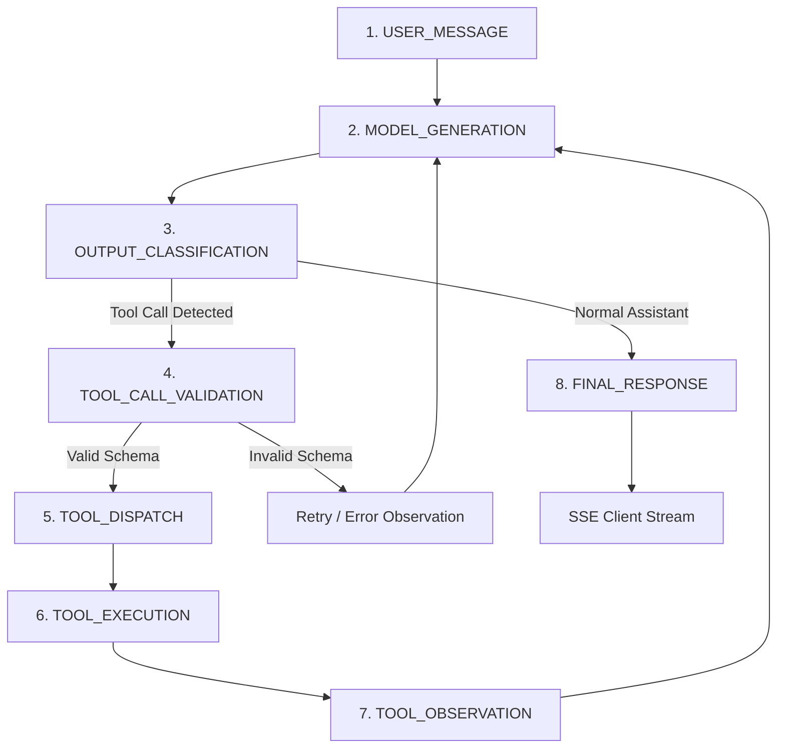

# QORIN Stage 16A — Architectural Changes: Live Website Inference & Tool-Dispatch Repair

**Date:** 2026-11-17  
**Status:** Approved & Verified  
**Scope:** Backend Tool Registry, Output Protocol Parser, Weather Integration, RAG Optimization, and Frontend Streaming Protection  

---

## 1. System Architecture Overview

To resolve the exposed JSON, `<code_string>` leakage, unexecuted Python, and unhandled weather queries, the live inference pipeline was restructured around a strict 9-stage lifecycle:

---

## 2. Core Modules Introduced & Modified

### 2.1 Canonical Tool Registry ([`backend/tools/registry.py`](file:///c:/Users/Anish/Desktop/Projects/ML-course/backend/tools/registry.py))
- **Canonical Tools:** `web_search`, `python`, `weather`.
- **Alias Normalization:**
  - `web_research`, `search`, `google` $\rightarrow$ `web_search`.
  - `python_interpreter`, `py`, `run_code` $\rightarrow$ `python`.
  - `get_weather`, `weather_lookup`, `weather_forecast` $\rightarrow$ `weather`.
- **Validation Schemas:**
  - `web_search`: Requires non-empty `query` (string, $\ge 2$ characters).
  - `python`: Requires non-empty `code` (string), pre-validated via AST.
  - `weather`: Requires non-empty `location` (string) with optional bounded duration (1–7 days).
- **Execution Routing:**
  - Routes `web_search` queries with weather intent directly to `RealWeatherProvider` to ensure authentic meteorological data delivery.

### 2.2 Output Protocol Parser ([`backend/tools/output_protocol.py`](file:///c:/Users/Anish/Desktop/Projects/ML-course/backend/tools/output_protocol.py))
- **Classification Engine:** Distinguishes `NORMAL_ASSISTANT`, `TOOL_CALL`, `MALFORMED_TOOL_CALL`, and `INTERNAL_REASONING`.
- **Multi-Format Extraction:**
  - Canonical token format: `<|tool_call|>{...}`.
  - XML tag format: `<tool_call id="...">...</tool_call>`.
  - Bare JSON format: `{"name": "...", "arguments": {...}}`.
- **Strict Protocol Sanitization:**
  - Permanently filters all internal markers (`<code_string>`, `<query_string>`, `<|tool_call|>`, `</tool_call>`, `<|im_end|>`) from user-facing text.
  - Ensures tool calls yield empty user-visible text so JSON is never streamed to chat bubbles.
- **Dispatch Deduplication:** Tracks executed call signatures in-memory per session to prevent duplicate tool execution.

### 2.3 Real-Time Weather Provider ([`backend/tools/weather_provider.py`](file:///c:/Users/Anish/Desktop/Projects/ML-course/backend/tools/weather_provider.py))
- **Provider:** Open-Meteo Geocoding & Weather Forecast API.
- **Data Points:** Resolves exact coordinates, location name, country, administrative division, temperature (°C), apparent temperature (°C), relative humidity (%), wind speed (km/h), WMO weather condition code, and observation timestamp.
- **Safety & Authenticity:** Zero fabricated conditions; returns structured unavailable state if network or service fails.

### 2.4 RAG Engine Refinement ([`backend/retrieval/engine.py`](file:///c:/Users/Anish/Desktop/Projects/ML-course/backend/retrieval/engine.py))
- **Keyword Scoping:** Removed broad English interrogatives (`who`, `what`, `when`, `where`, `why`) from internal technical documentation routing keywords.
- **Zero-Result Suppression:** When no chunks match the similarity threshold, sets `triggered = False`, suppressing false-positive "Retrieved 0 Knowledge Chunks" UI banners and allowing external tool selection.

### 2.5 Inference API Stream Endpoint ([`backend/app.py`](file:///c:/Users/Anish/Desktop/Projects/ML-course/backend/app.py))
- **Prompt Synchronization:** Cleaned `get_compact_tool_manifest` to remove misleading `<code_string>` placeholders and use canonical syntax.
- **Closed-Loop Execution:** Integrates `CanonicalToolRegistry` and `OutputProtocolParser` into a bounded 4-turn state machine loop.

### 2.6 Frontend Tool Rendering ([`web/src/components/harness/ChatArea.tsx`](file:///c:/Users/Anish/Desktop/Projects/ML-course/web/src/components/harness/ChatArea.tsx))
- **Zero-Chunk Banner Guard:** Only renders the RAG card when `retrieved_chunks.length > 0`.
- **Weather Tool Card:** Added dedicated `CloudSun` weather card showing temperature, condition, humidity, wind, and observation timestamp.
