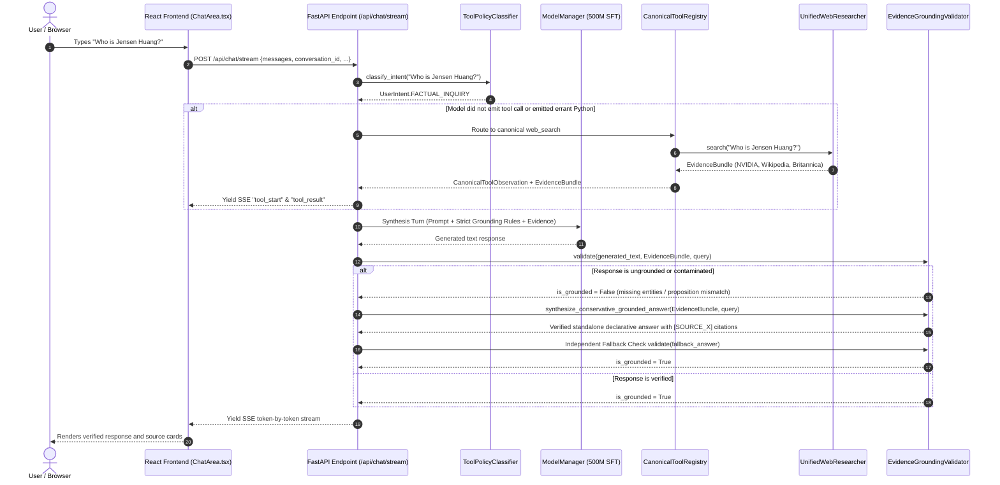

# End-to-End Inference Path Map

## Overview

This document maps the complete execution path traversed by a live user request from the React frontend through the backend inference engine, policy classification, tool orchestration, grounding validation, and client streaming.

---

## 1. Sequence Flow Diagram

---

## 2. Component Responsibilities

1. **Frontend (`web/src/components/harness/ChatArea.tsx`)**:
   - Manages message history with stable IDs (`msg-${Date.now()}`).
   - Manages conversation scoping via `conversationIdRef.current`.
   - Sends user prompt and prior conversation context to `/api/chat/stream`.

2. **Policy Classification (`backend/tools/policy.py`)**:
   - Classifies user message into `CODE_GENERATION`, `SIMPLE_ARITHMETIC`, `EXPLICIT_EXECUTION`, or `FACTUAL_INQUIRY`.
   - Enforces execution boundaries (prevents Python calls on general factual queries).

3. **Tool Orchestration (`backend/app.py`)**:
   - Routes `FACTUAL_INQUIRY` to `web_search` when `web_research_enabled` is active.
   - Converts errant Python calls on entity queries to `web_search`.
   - Emits structured `tool_start` and `tool_result` events.

4. **Structured Evidence Handling (`backend/tools/evidence.py`)**:
   - Serializes retrieved sources into `EvidenceBundle` and `EvidenceRecord` instances with ISO 8601 timestamps, URLs, snippets, and entity tags.

5. **Deterministic Grounding Validator (`backend/tools/grounding_validator.py`)**:
   - Sentence-level co-occurrence checking.
   - Contradiction and self-referential impossibility detection.
   - Independent verification of fallback synthesis.
