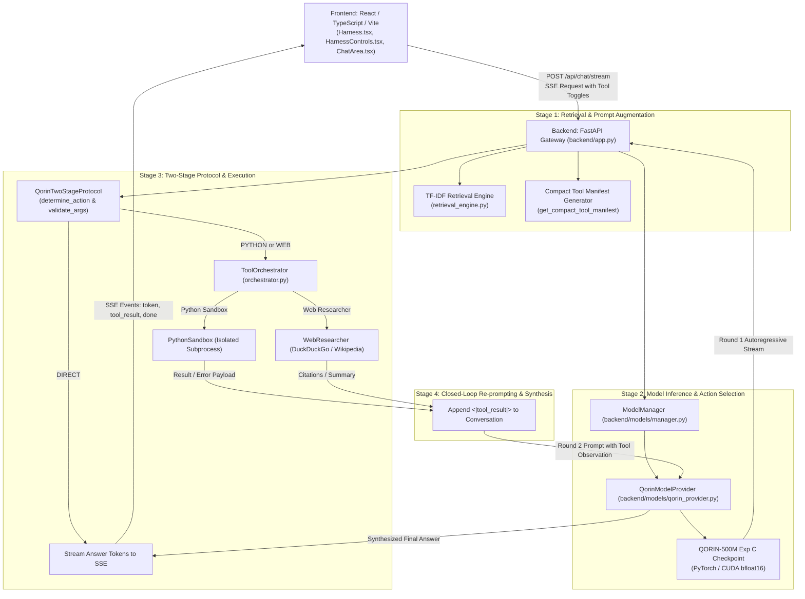

# QORIN Application & Harness Architecture Audit

**Audit Date:** November 17, 2026  
**Audited Target:** QORIN Application Stack & Closed-Loop Tool Harness  
**Authoritative Checkpoint:** `modern_gpt/experiments/phase2_experiment_c/stage_3_training/checkpoints/ckpt_experiment_c_final.pt` (SHA-256: `6cb5125896bbe1d82b247212b2de7bc18832561c39d0be6a8dbc25724e839a1b`)  
**Audit Status:** **VERIFIED (Closed-Loop Operational)**

---

## 1. System Overview

The QORIN application is an open-weights small language model research harness designed to evaluate the boundary between internal parametric capabilities (514M ModernGPT-S decoder-only Transformer) and external tool augmentation (TF-IDF retrieval, Python sandbox execution, and live Web research).

---

## 2. Complete 10-Step End-to-End Execution Trace

### Step 1: Model Selection & Loading
- The user selects a checkpoint via the `HarnessControls` dropdown.
- `POST /api/models/select` dispatches `model_manager.select_model(model_id)`.
- If an existing model occupies VRAM, `qorin_provider.unload_model()` flushes CUDA caches (`torch.cuda.empty_cache()` and `gc.collect()`).
- The provider instantiates `ModernGPT(config)` using the canonical 20-layer, 24-head, 4-KV head, 2048-context architecture and loads weights from `ckpt_experiment_c_final.pt` in `bfloat16` precision.

### Step 2: Tokenizer & Configuration Binding
- The provider binds `modern_gpt/artifacts/tokenizer_32k` (BPE 32,768 vocabulary) containing atomic special tokens `<|im_start|>`, `<|im_end|>`, `<|tool_call|>`, `<|tool_result|>`, and `<|tool_error|>`.
- Model configuration is locked to 2,048 tokens context length with default RoPE parameters ($\theta=10000.0, s=1.0$).

### Step 3: Capability Toggle Ingestion
- User controls in `HarnessControls.tsx` manage two independent boolean flags:
  - `web_research_enabled` (Default: `false` / OFF)
  - `python_sandbox_enabled` (Default: `false` / OFF)
- Toggles are delivered in the JSON payload of `POST /api/chat/stream`.

### Step 4: Capability Manifest Prompt Injection
- `backend/app.py` computes `compact_manifest = get_compact_tool_manifest(web_enabled, python_enabled)`.
- When both are OFF: `compact_manifest` is `None`, enforcing strict standalone parametric inference.
- When Python is ON: only the isolated Python sandbox tool schema is declared.
- When Web is ON: only the Web research tool schema is declared.
- When both are ON: both schemas are declared.
- The manifest is prepended to the system prompt inside the ChatML template.

### Step 5: Autoregressive Action Determination (Stage A)
- `model_manager.generate_stream` executes Round 1 generation.
- The model chooses between:
  1. **DIRECT:** Emits plain conversational text without special tags.
  2. **PYTHON:** Emits `<|tool_call|>{"name": "python", "arguments": {"code": "..."}}`.
  3. **WEB:** Emits `<|tool_call|>{"name": "web_research", "arguments": {"query": "..."}}`.
- `QorinTwoStageProtocol.determine_action` parses the generation text and cross-references active permission toggles. If a disabled tool is called, it is strictly blocked.

### Step 6: Argument Schema Validation & AST Inspection (Stage B)
- Before dispatching any tool, `validate_and_sanitize_arguments` verifies arguments:
  - For `python`: Verifies the presence of `"code"` and parses it with Python's Abstract Syntax Tree (`ast.parse`). Syntax errors are caught before subprocess spawn.
  - For `web_research`: Verifies non-empty query strings and strips extraneous characters.
- If invalid: Emits `<|tool_error|>` immediately and provides structured error feedback.

### Step 7: Sandboxed Tool Execution
- **Python Sandbox:**
  - Creates a dedicated ephemeral directory (`backend/data/sandbox/run_<uuid>`).
  - Prepends a security restriction header setting dangerous imports (`socket`, `urllib`, `subprocess`, `shutil`) to `None`.
  - Spawns an isolated subprocess with `-I` (isolated environment) and cleaned environment variables.
  - Enforces a 5.0-second execution timeout and 50,000-byte output buffer.
- **Web Researcher:**
  - Queries DuckDuckGo Lite HTML interface or Wikipedia Search API.
  - Enforces a 4.0-second network timeout.
  - Extracts clean snippets, titles, and verifiable URLs.

### Step 8: Closed-Loop Tool Result Return
- Emits an SSE event `tool_result` to update the frontend UI.
- Appends the assistant's tool invocation to `active_messages`:
  `{"role": "assistant", "content": round_response_text}`
- Appends the tool observation payload:
  `{"role": "tool", "content": "<|tool_result|>" + json.dumps(output_payload)}`

### Step 9: Second-Stage Synthesis (Round 2)
- Re-invokes `model_manager.generate_stream` with updated `active_messages`.
- The model reads its prior tool call and the external execution result.
- Synthesizes a factual, grounded response citing tool results.
- Synthesized tokens stream to the client via SSE `token` events.

### Step 10: Client Receipt & Structured Trace Persistence
- `ChatArea.tsx` consumes the event stream:
  - Renders inline tool execution cards (latency, stdout/stderr, sources).
  - Streams synthesized text in real time.
- `backend/app.py` logs the complete trace (input messages, retrieval trace, tool traces, latency, TTFT, token counts) to `backend/data/experiment_traces.jsonl`.

---

## 3. Discrepancy Audit: UI Display vs Backend Enforcement

| Feature | Frontend UI State | Backend Enforcement Status | Discrepancy / Alignment |
| :--- | :--- | :--- | :--- |
| **Tool Toggles Default** | Default unchecked (`false`) in `DEFAULT_SETTINGS` | Default `web=False, py=False` in Pydantic schema | **ALIGNED** |
| **Independent Control** | Two separate checkbox inputs in `HarnessControls.tsx` | Separate boolean flags in `ChatRequest` | **ALIGNED** |
| **Python Isolation** | UI displays "Isolated Python Sandbox" | Subprocess spawned with `-I`, blocked socket/subprocess imports | **ALIGNED** |
| **Web Retrieval Safety** | UI displays "Web Research" | Subprocess blocked; URL requests bounded to DuckDuckGo/Wikipedia | **ALIGNED** |
| **Disabled Tool Dispatch** | UI hides tool status badges when disabled | `two_stage_protocol` blocks dispatch; returns `DIRECT` | **ALIGNED (Fixed in DEF-04)** |
| **Multi-Round Limiter** | Not exposed in UI | Hardcoded `max_tool_rounds = 2` prevents infinite loops | **ALIGNED** |
