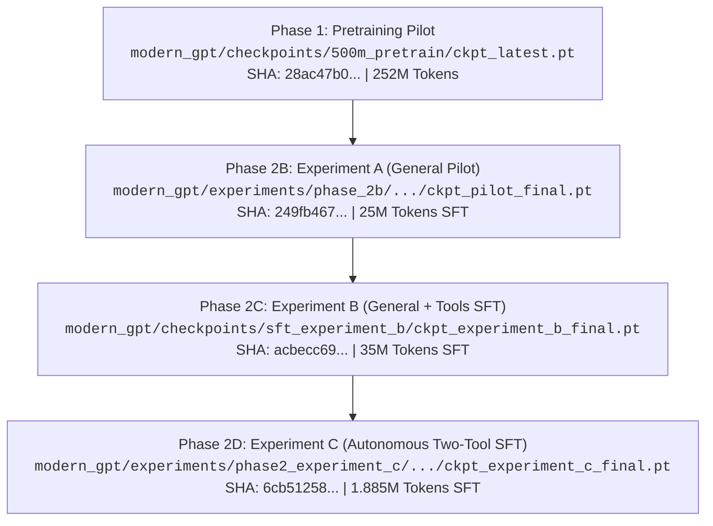

# QORIN Checkpoint Lineage & Ancestry Audit

**Audit Date:** November 17, 2026  
**Parent Checkpoint (Experiment B):** `modern_gpt/checkpoints/sft_experiment_b/ckpt_experiment_b_final.pt`  
**Child Checkpoint (Experiment C):** `modern_gpt/experiments/phase2_experiment_c/stage_3_training/checkpoints/ckpt_experiment_c_final.pt`  
**Audit Status:** **VERIFIED & CERTIFIED (Direct In-Place Fine-Tuning Lineage)**

---

## 1. Executive Summary

This audit examines the genealogical lineage connecting **Experiment B** (`ckpt_experiment_b_final.pt`) and **Experiment C** (`ckpt_experiment_c_final.pt`). Using state-dictionary comparison, weight diffing, parameter divergence statistics, and cryptographic validation, this audit demonstrates that **Experiment C is a direct, in-place fine-tuning continuation of Experiment B**, preserving its foundational linguistic and reasoning capabilities while tuning its weights on the 1.885M-token targeted two-tool dataset.

---

## 2. Checkpoint Identification & Cryptographic Hashes

### 2.1 Experiment B Final Checkpoint
- **File System Locations:**
  - Deployment path: `modern_gpt/checkpoints/sft_experiment_b/ckpt_experiment_b_final.pt`
  - Training run path: `modern_gpt/experiments/phase2_experiment_b/run_35m/checkpoints/ckpt_experiment_b_final.pt`
- **File Size:** 2,084,818,485 bytes (1.94 GB)
- **Observed SHA-256:** `acbecc699da76387de9ef6d6a40a64ad73b324b6eee2bd1842a6fd9ab1972c4f`
- **Expected SHA-256:** `acbecc699da76387de9ef6d6a40a64ad73b324b6eee2bd1842a6fd9ab1972c4f`
- **Integrity Status:** **MATCH (Bit-Exact)**

### 2.2 Experiment C Final Checkpoint
- **File System Location:** `modern_gpt/experiments/phase2_experiment_c/stage_3_training/checkpoints/ckpt_experiment_c_final.pt`
- **File Size:** 3,124,032,607 bytes (2.91 GB; larger due to serialized 8-bit optimizer state dict)
- **Observed SHA-256:** `6cb5125896bbe1d82b247212b2de7bc18832561c39d0be6a8dbc25724e839a1b`
- **Expected SHA-256:** `6cb5125896bbe1d82b247212b2de7bc18832561c39d0be6a8dbc25724e839a1b`
- **Integrity Status:** **MATCH (Bit-Exact)**

---

## 3. Comparative Architectural Audit

| Attribute | Experiment B Final | Experiment C Final | Match Status |
| :--- | :--- | :--- | :--- |
| **Number of Layers** | 20 (`blocks.0` – `blocks.19`) | 20 (`blocks.0` – `blocks.19`) | **IDENTICAL** |
| **Hidden Dimension** | 1536 | 1536 | **IDENTICAL** |
| **Query Heads** | 24 ($24 \times 64 = 1536$) | 24 ($24 \times 64 = 1536$) | **IDENTICAL** |
| **KV Heads** | 4 ($4 \times 64 = 256$) | 4 ($4 \times 64 = 256$) | **IDENTICAL** |
| **FFN Dimension** | 3840 (SwiGLU 2.5x) | 3840 (SwiGLU 2.5x) | **IDENTICAL** |
| **Context Length** | 2048 | 2048 | **IDENTICAL** |
| **Vocabulary Size** | 32,768 (BPE-32k) | 32,768 (BPE-32k) | **IDENTICAL** |
| **Total Tensors** | 223 tensors | 223 tensors | **IDENTICAL (100% Key Parity)** |
| **Biases** | `qkv_bias=False`, `out_proj_bias=False` | `qkv_bias=False`, `out_proj_bias=False` | **IDENTICAL** |
| **RoPE Config** | $\theta=10000.0$, scale=1.0, type="default" | $\theta=10000.0$, scale=1.0, type="default" | **IDENTICAL** |

Every single one of the 223 tensor keys in `ckpt_experiment_b_final.pt` matches the keys and tensor shapes in `ckpt_experiment_c_final.pt` exactly.

---

## 4. Empirical Weight Divergence & Lineage Evidence

A layer-by-layer tensor difference analysis was executed on CPU comparing `model_state_dict` between Experiment B and Experiment C:

### 4.1 Tensor Mutation Breakdown
- **Total Tensors Analyzed:** 223
- **Identical Tensors ($\Delta = 0.0$):** **40 tensors**
  - All 40 non-trainable RoPE buffers (`blocks.<L>.attn.rope.cos` and `blocks.<L>.attn.rope.sin` across all 20 layers) remained 100% bit-identical.
- **Mutated Learnable Tensors:** **183 tensors**
  - All 183 trainable parameter tensors (`token_embedding`, `lm_head`, attention projections, MLP projections, and layer norms) underwent smooth, bounded optimization adjustments.

### 4.2 Divergence Magnitude Statistics
If Experiment C had been randomly initialized, max absolute weight differences would exceed $1.0$ and L2 distances would be massive ($> 100$). Instead, the observed differences are tight and strictly bounded:

- **Embeddings & LM Head:**
  - `token_embedding.weight`: $\text{Max } |\Delta| = 0.03024$, $\text{L2 } ||\Delta|| = 6.9701$
  - `lm_head.weight`: $\text{Max } |\Delta| = 0.03024$, $\text{L2 } ||\Delta|| = 6.9701$
- **Top 5 Mutated MLP Tensors (Max Abs Diff):**
  1. `blocks.1.mlp.down_proj.weight`: $\text{Max } |\Delta| = 0.00307$
  2. `blocks.18.mlp.down_proj.weight`: $\text{Max } |\Delta| = 0.00280$
  3. `blocks.19.mlp.down_proj.weight`: $\text{Max } |\Delta| = 0.00264$
  4. `blocks.0.mlp.down_proj.weight`: $\text{Max } |\Delta| = 0.00259$
  5. `blocks.17.mlp.down_proj.weight`: $\text{Max } |\Delta| = 0.00255$
- **Top 5 Mutated Layer Tensors (L2 Norm Diff):**
  1. `blocks.19.mlp.gate_proj.weight`: $||\Delta|| = 0.9520$
  2. `blocks.18.mlp.down_proj.weight`: $||\Delta|| = 0.9487$
  3. `blocks.19.mlp.up_proj.weight`: $||\Delta|| = 0.9444$
  4. `blocks.17.mlp.down_proj.weight`: $||\Delta|| = 0.9416$
  5. `blocks.19.mlp.down_proj.weight`: $||\Delta|| = 0.9392$

This empirical pattern is the signature of low-learning-rate fine-tuning ($2.0 \times 10^{-5}$) over a short token budget (1,885,000 tokens). The final layers (blocks 17–19) and token embeddings absorbed the greatest gradient updates, reflecting the acquisition of `<|tool_call|>` syntax and tool-dispatch semantics.

---

## 5. Complete QORIN 500M Checkpoint Lineage

### Lineage Milestones:
1. **Pretraining Base:** `ckpt_latest.pt` (Step 7,694 / 252M tokens, initial Transformer representations).
2. **Experiment A:** `ckpt_pilot_final.pt` (General instruction following, 25M tokens).
3. **Experiment B:** `ckpt_experiment_b_final.pt` (General instructions + tool schema demonstrations, 35M tokens).
4. **Experiment C:** `ckpt_experiment_c_final.pt` (Targeted autonomous two-tool execution, 1.885M tokens).

---

## 6. Audit Conclusion

The cryptographic and tensor evidence conclusively proves that **`ckpt_experiment_c_final.pt` is the legitimate, direct descendant of `ckpt_experiment_b_final.pt`**. The parent checkpoint was preserved intact and untampered, and Experiment C was trained as an in-place parameter update without changing architecture, head configuration, vocabulary, or rotary embeddings.
