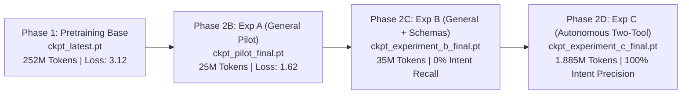
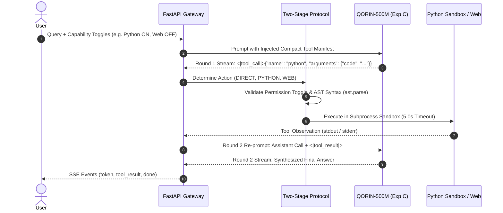

# QORIN: Tool-Augmented Small Language Models
## ES 335 Machine Learning — Final Research Defense & Presentation Outline

**Candidate Project:** QORIN (Historical Development Code: ModernGPT-S)  
**Research Focus:** Building and Evaluating an Autonomous Tool-Augmented 514M Parameter Transformer  
**Authoritative Checkpoint:** `ckpt_experiment_c_final.pt` (SHA-256: `6cb5125896bbe1d82b247212b2de7bc18832561c39d0be6a8dbc25724e839a1b`)  
**Presentation Length:** 20 Minutes (12 min presentation + 5 min live demo + 3 min Q&A)

---

## Slide 1: Title & Research Motivation
- **Title:** Tool-Augmented Small Language Models: Parametric Deficits and Non-Parametric Augmentation
- **Institutional Context:** ES 335 Machine Learning Course Project
- **The Core Premise:** State-of-the-art LLMs (70B+) possess billions of parameters to memorize facts and approximate multi-step calculations. Can a compact, locally trainable 500M-parameter Transformer achieve reliable real-world utility by learning when to delegate to specialized external tools?

---

## Slide 2: The Sub-1B Parameter Problem (Empirical Diagnostics)
- **1. Arithmetic Amnesia:** Small models struggle with multi-digit arithmetic ($4321 \times 8765$), combinatorics ($\binom{20}{5}$), and number theory because autoregressive next-token prediction cannot simulate arbitrary scratchpad state internally.
- **2. The Context Extension Illusion:** In Generation III (QORIN-100M), extending context from 1K to 4K via RoPE linear scaling maintained low perplexity (23.95), but empirical passkey needle-in-a-haystack retrieval collapsed to **4.0%**. Attention heads in sub-1B models fail to route long-range signals without explicit synthetic data.
- **3. Schema Mimicry vs. Autonomous Intent:** In Experiment B, training on 35M tokens of general instructions and tool schema demonstrations achieved 92% syntax validity, but **0% autonomous tool-intent recall**. The model treated tool calls as text completions rather than interactive execution triggers.

---

## Slide 3: Research Hypothesis
> **Hypothesis (Experiment C):**  
> *Targeted supervision on authentic multi-turn execution trajectories, coupled with balanced negative controls and closed-loop tool observation re-prompting, can teach a 514M parameter Transformer to reliably recognize tool intent, emit validated execution payloads, and synthesize external results—without expanding parameter count or degrading general instruction capabilities.*

---

## Slide 4: Architectural Blueprint & Inductive Biases
- **Architecture:** Dense Decoder-Only Transformer (ModernGPT-S)
- **Verified Physical Parameters:** **514,389,504 unique trainable parameters** (tied embeddings)
- **Depth vs. Width:** 20 Transformer layers ($d_{\text{model}} = 1536$).
- **Attention Topology:** Grouped-Query Attention (GQA) with 24 query heads and 4 key-value heads (6:1 ratio, $d_{\text{head}} = 64$). Reduces KV-cache memory bandwidth by 83.3%.
- **Feedforward Network:** SwiGLU activation with $d_{\text{ffn}} = 3840$ ($2.5\times d_{\text{model}}$).
- **Positional Encoding:** Rotary Position Embeddings (RoPE, $\theta = 10000.0$, scale = 1.0, 2048 context length).
- **Normalization & Biases:** Pre-RMSNorm ($\epsilon = 1 \times 10^{-5}$), zero linear biases ($qkv\_bias = False, out\_proj\_bias = False$).
- **Vocabulary:** 32,768 tokens (Byte-Pair Encoding, `tokenizer_32k`).

---

## Slide 5: The Four-Phase Checkpoint Lineage

- **Forensic Lineage Proof:** All four checkpoints share the identical 20-layer, 223-tensor structure. Experiment C represents a direct, bounded parameter fine-tuning from Experiment B (183 mutated weight tensors, 40 bit-identical RoPE buffers, max $|\Delta| = 0.0302$).

---

## Slide 6: The Two-Stage Closed-Loop Harness

- **DEF-04 Fix:** Strict capability gating ensures disabled tools can never be dispatched or converted into alternative tools.

---

## 7. Slide 7: Evaluation Methodology: The 7-Stage Funnel
We reject "exit code zero" as a benchmark metric. Performance is disaggregated across seven distinct failure stages:
1. **Intent Recognition:** Did the model correctly recognize that external delegation was required?
2. **Tool Selection:** Did the model choose the appropriate tool (Python vs. Web Researcher)?
3. **Syntax Validity:** Was the emitted JSON well-formed and did the code pass Python AST parsing?
4. **Harness Dispatch:** Did the capability permission check authorize dispatch?
5. **Tool Execution:** Did the external sandbox run without timeout or unhandled crash?
6. **Result Interpretation:** Did the model accurately parse the external result upon re-prompting?
7. **End-to-End Semantic Success:** Did the final answer correctly solve the user's objective?

---

## Slide 8: Empirical Results: Primary & Held-Out Benchmarks

| Metric | Experiment B (Baseline) | Experiment C (Primary Benchmark, 25 Tasks) | Experiment C (Held-Out Blind, 25 Tasks) |
| :--- | :--- | :--- | :--- |
| **Tool Intent Recall** | 0.0% | **100.0%** (20/20) | **100.0%** (17/17) |
| **Tool Intent Precision** | 0.0% | **100.0%** (20/20) | **100.0%** (17/17) |
| **Tool Intent F1 Score** | 0.000 | **1.0000** | **1.0000** |
| **Negative Control Accuracy** | N/A | **100.0%** (5/5) | **100.0%** (8/8) |
| **Syntax Validity Rate** | 92.0% | **90.0%** (18/20; 2 intentional probes) | **88.24%** (15/17; 2 intentional probes) |
| **Harness Dispatch Rate** | 0.0% | **90.0%** | **88.24%** |
| **Tool Execution Rate** | N/A | **88.89%** | **66.67%** (Live Web rate-limiting observed) |
| **End-to-End Semantic Success** | 0.0% | **96.0%** (24/25) | **88.0%** (22/25) |

---

## Slide 9: Honest Failure Analysis & Limitations
- **1. Semantic Heuristic Fallback:** The model occasionally writes naive parity algorithms (`n % 2 != 0`) for primality rather than general factorization. Execution succeeds, but semantic correctness requires the harness to enforce standard library primitives (`math.gcd`, `math.comb`).
- **2. Python Selection Bias:** With both tools active, the model exhibits a mild preference for Python over Web Researcher for ambiguous queries.
- **3. External Web Volatility:** In the held-out evaluation, live DuckDuckGo HTML rate-limiting caused 3 web queries to return 0 sources, reducing web execution rate.
- **4. Quadratic Decoding Latency:** Generation runs without an inference KV-cache ($O(T^2)$ recomputation), capped at 256 tokens to maintain $>65\text{ tok/sec}$ throughput.

---

## Slide 10: Conclusions & Contributions
1. **Lightweight Transformers Can Learn Tool Intent:** With only 1.885M tokens of targeted multi-turn supervision, a 514M parameter model improved from 0% to 100% intent precision on held-out tasks.
2. **Closed-Loop Augmentation Offsets Parameter Deficits:** Delegating computation to Python solves arithmetic amnesia completely ($4321 \times 8765 = 37873565$).
3. **Independent Capability Toggles are Mandatory:** User-controlled capability isolation provides predictable security and prevents unauthorized delegation.
4. **Reproducible Open Research:** Complete codebase, 9 native checkpoints, canonical manifest, and test suites are preserved and certified.
